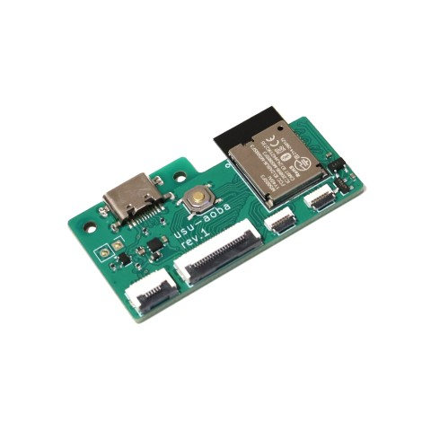
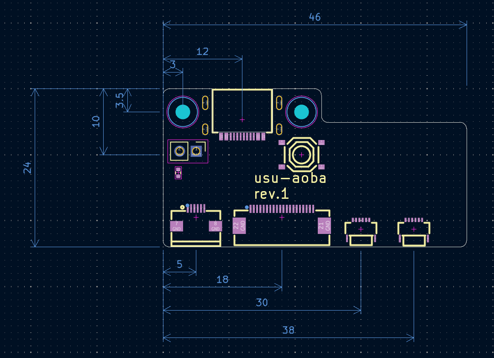

# usu-aoba

usu-aobaはnRF52840を搭載した、乾電池駆動対応の薄型マイコンボードです。

キーボード基板とはFPCケーブルで接続でき、18本のGPIOを利用可能です。さらに、トラックパッドやトラックボールなどの拡張モジュールを接続するための6ピンFPCコネクタ ([KDK-Link](https://kdk-link.pages.dev/))も搭載しています。

省スペースな構成で、薄型ワイヤレスキーボードの製作に適しています。



本ページははusu-aoba rev.1の情報です。
rev.1では消費電力を削減し、拡張ポートの数が3に増えています。また、1つ目の拡張ポートのピン割り当てが変更されており、GPIO7~10から独立しました。
電源・マトリクス用の20pコネクタのピン配置は変わっていません。

rev.0の情報は[こちら](rev0.md)

## 寸法




## ピン配置

0.5mmピッチの20p FFCコネクタと6p FFCコネクタを搭載しています。

### 20pコネクタ

| 番号 | ラベル         | 接続  |
| ---- | -------------- | ----- |
| 1    | +BAT(1.0~3.3V) |       |
| 2    | GND            |       |
| 3    | GPIO18         | P1.13 |
| 4    | GPIO17         | P1.15 |
| 5    | GPIO16         | P0.02 |
| 6    | GPIO15         | P0.29 |
| 7    | GPIO14         | P0.31 |
| 8    | GPIO13         | P0.26 |
| 9    | GPIO12         | P0.06 |
| 10   | GPIO11         | P0.08 |
| 11   | GPIO10         | P1.09 |
| 12   | GPIO9          | P0.12 |
| 13   | GPIO8          | P0.13 |
| 14   | GPIO7          | P0.15 |
| 15   | GPIO6          | P0.20 |
| 16   | GPIO5          | P0.22 |
| 17   | GPIO4          | P0.24 |
| 18   | GPIO3          | P1.00 |
| 19   | GPIO2          | P0.09 |
| 20   | GPIO1          | P0.10 |


### 6pコネクタ

usu-aoba rev.1では[KDK-Link](https://kdk-link.pages.dev/)に対応した拡張ポートを3つ搭載しています。

| 番号 | ラベル    | 接続  |
| ---- | --------- | ----- |
| 1    | GND       |       |
| 2    | EXT1-1    | P0.23 |
| 3    | EXT1-2    | P0.21 |
| 4    | EXT1-3    | P1.14 |
| 5    | EXT1-4    | P0.03 |
| 6    | VCC(3.3V) |       |

| 番号 | ラベル    | 接続  |
| ---- | --------- | ----- |
| 1    | GND       |       |
| 2    | EXT2-1    | P0.05 |
| 3    | EXT2-2    | P0.04 |
| 4    | EXT2-3    | P1.08 |
| 5    | EXT2-4    | P0.07 |
| 6    | VCC(3.3V) |       |

| 番号 | ラベル    | 接続  |
| ---- | --------- | ----- |
| 1    | GND       |       |
| 2    | EXT3-1    | P0.11 |
| 3    | EXT3-2    | P0.16 |
| 4    | EXT3-3    | P0.14 |
| 5    | EXT3-4    | P0.19 |
| 6    | VCC(3.3V) |       |

## ブートローダ起動方法

リセットスイッチを素早く2回押してください

## ファームウェア

[ZMK用コンポーネント](https://github.com/sekigon-gonnoc/zmk-component-usu-aoba)

ビルド時にはボードバージョンに1を指定してください。

```yaml
include:
  - board: usu_aoba@1.0.0
    shield: <your-shield>
```